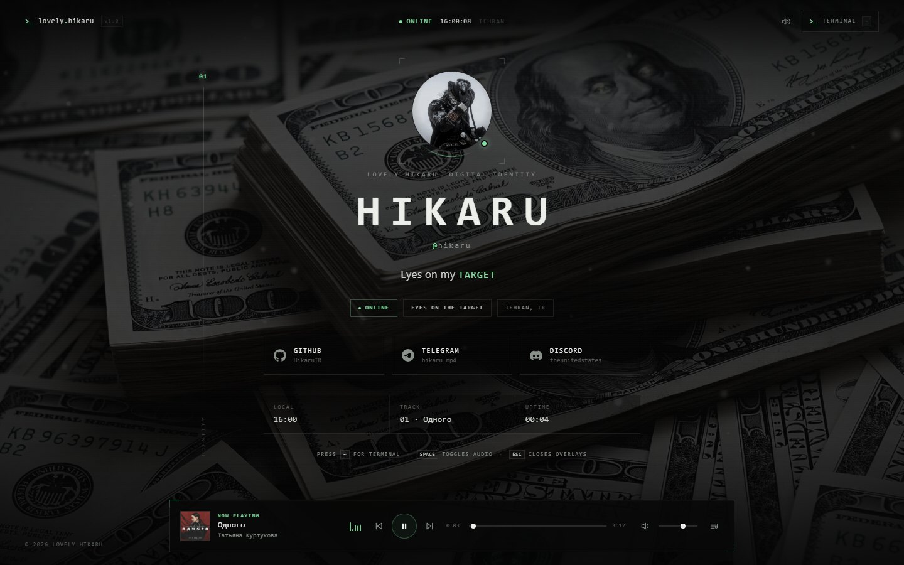
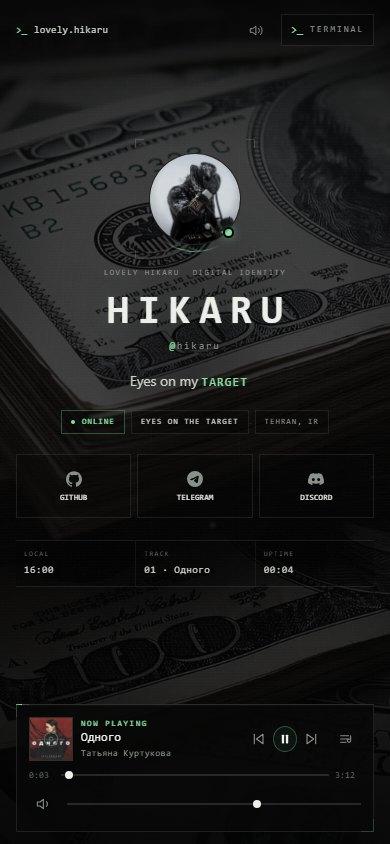
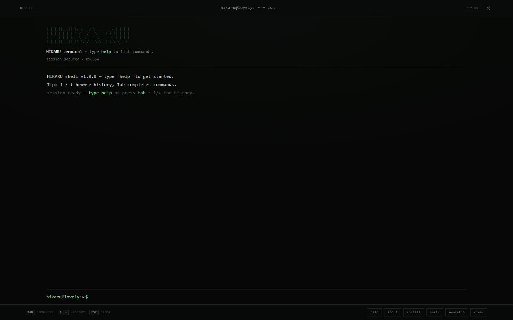
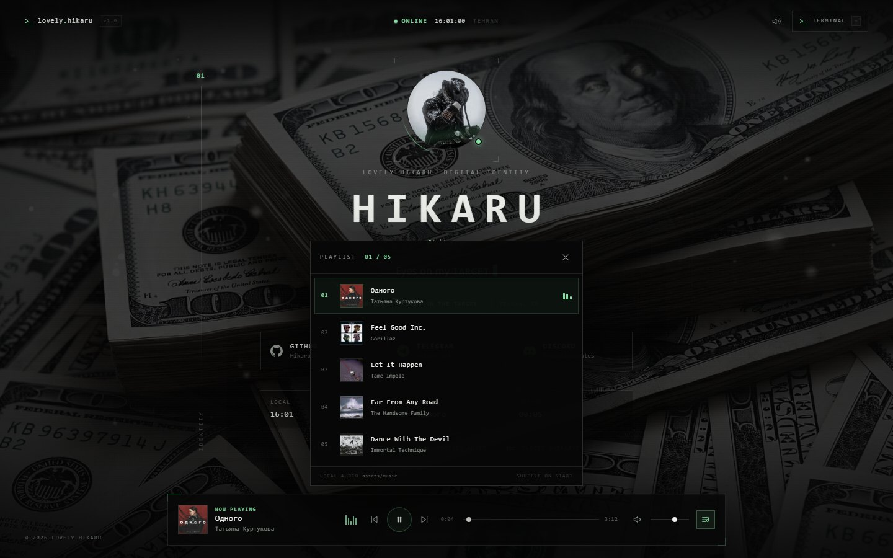

# HIKARU — Lovely Hikaru

A terminal-inspired personal profile site. One page, no build step, no framework, no CDN — a boot log that hands you a real terminal prompt, a profile plate, a mini player and a full-screen terminal over a foggy, muted-green backdrop. Designed for GitHub Pages and for looking like it was built on purpose.

**Concept:** *Eyes on my TARGET.* A terminal-side digital identity — HIKARU. Dark, quiet, monospace, one restrained green accent, and nothing that needs a network request at runtime.

---

## Preview

<p>
  
  
</p>





---

## What you get

- **Boot log → full-screen terminal gate** — the init lines type themselves, then the screen becomes a prompt (`hikaru@lovely:~$`). Typing `start` and pressing `Enter` (or clicking `[ start ]`) opens the profile.
- **Profile plate** — avatar with brackets and status dot, handle, bio, status chips, social links, and a live session strip (local time, current track, uptime).
- **Full-screen terminal** — a real command shell that fills the whole viewport, opened after entry with `~`, `` ` `` or `/`. History, tab completion, custom commands.
- **Mini player** — 5-track playlist with real album artwork (track cover in the player bar and thumbnails in the playlist), Одного as the default track, fade-in, volume memory for the session, seek bar, keyboard space-bar toggle.
- **Background layer** — muted video or image, darkening overlay, vignette, grid, scanlines and grain, plus an optional cursor spotlight on desktop.
- **Static assets only** — every image, icon and audio file lives in `assets/`. There is no runtime dependency on any external service or font.

---

## Project structure

```
lovely-hikaru/
├── index.html
├── css/            (base, background, boot, profile, player, terminal, responsive)
├── js/             (config, utils, background, boot, profile, player, terminal, main)
├── assets/
│   ├── backgrounds/  background.mp4 · poster.jpg · fallback.jpg
│   ├── covers/       feel-good-inc.jpg · let-it-happen.jpg · far-from-any-road.jpg ·
│   │                 dance-with-the-devil.jpg · odnogo.jpg
│   ├── icons/        github.svg · telegram.svg · discord.svg · favicon.svg · apple-touch-icon.png
│   ├── music/        feel-good-inc.mp3 · let-it-happen.mp3 · far-from-any-road.mp3 ·
│   │                 dance-with-the-devil.mp3 · odnogo.mp3
│   ├── og/           og-image.jpg
│   └── profile/      avatar.jpg
└── README.md
```

Script order matters and is fixed in `index.html`: `config.js` → `utils.js` → `background.js` → `boot.js` → `profile.js` → `player.js` → `terminal.js` → `main.js`.

---

## Run it locally

Serve the folder over HTTP so the browser handles audio and video normally:

```bash
cd lovely-hikaru
python -m http.server 8000
```

Then open <http://localhost:8000>. Any static server works; VS Code's **Live Server** extension is fine too. If `python` is not on your PATH on Windows, use `py -m http.server 8000`.

Opening `index.html` directly (`file://`) also renders the page, but browsers may restrict media loading and playback in that mode — for a faithful check, use a local server.

---

## Customise everything

Almost everything lives in **`js/config.js`**, on the `window.SITE` object. Edit the file, refresh the page; there is no build step.

| What you want to change | Where | Keys |
| --- | --- | --- |
| Page title, description, theme colour, footer year | `SITE.meta` | `brand`, `title`, `description`, `themeColor`, `year` |
| Name, handle, bio, status, location, timezone | `SITE.profile` | `username`, `handle`, `bioLead`, `bioAccent`, `status`, `customStatus`, `location`, `timezone` |
| About text printed by `about` (gate and terminal) | `SITE.profile.about` | array of strings, one output line each |
| Profile tags | `SITE.profile.tags` | array of strings |
| Avatar image | `SITE.profile.avatar` | default `assets/profile/avatar.jpg` |
| Social links and their order | `SITE.socials` | array of `{ id, icon, label, handle, url }`; `icon` must be `github`, `telegram` or `discord` |
| Background media, darkening and effects | `SITE.background` | `type`, `src`, `poster`, `fallback`, `overlay`, `focusDim`, `loadAfterStart`, `spotlight`, `scanlines`, `grain`, `grid`, `position` |
| Playlist, volume and playback behaviour | `SITE.music` | `enabled`, `autoplayOnStart`, `startRandom`, `volume`, `rememberVolume`, `fadeIn`, `tracks[]` |
| Boot log and the terminal gate | `SITE.boot` | `lines[]`, `ready`, `typeSpeed`, `lineDelay`, `allowSkip`, `gate.openCommands`, `gate.hint`, `gate.autoFocus` |
| Terminal prompt, welcome text, custom commands | `SITE.terminal` | `enabled`, `user`, `host`, `cwd`, `welcome[]`, `customCommands{}` |
| Small interface switches | `SITE.ui` | `clock24h`, `showColophon`, `shortcuts`, `crt` |

Notes that save time:

- Keep the commas and quotes intact — it is plain JavaScript, not JSON.
- `SITE.background.overlay` is a `0–1` value. `0` leaves the media untouched, `1` is solid black. `0.45–0.8` is the readable range; `0.62` is the shipped default. `focusDim` adds a little extra darkening behind the profile plate.
- `SITE.background.loadAfterStart: true` delays loading the video until the gate is passed, which keeps the first paint fast. Set it to `false` to load immediately.
- `SITE.music.volume` is `0–1`. `autoplayOnStart` relies on the gate's start action as the required user gesture.
- `SITE.boot.allowSkip: true` enables `?skipboot=1` (or `?skipboot=true`) to skip the boot log and the gate entirely and go straight to the profile.
- `SITE.terminal.customCommands` maps a command name to an array of output lines, for example `fav: ['my favourite thing? come on — my target matters more.']`. They appear in `help` under CUSTOM.

---

## Entry flow: boot log → terminal gate

The first screen is a full-screen terminal, not a loading animation with a button glued on:

1. The boot log types the lines from `SITE.boot.lines`, each with an elapsed-time stamp and a tag.
2. When the log finishes, the boot panel reveals a prompt: `hikaru@lovely:~$`, followed by a live input caret and the hint text.
3. The visitor types an open command and presses `Enter`. The shipped `SITE.boot.gate.openCommands` are `start`, `open`, `enter`, `profile` and `go`, so any of those works. The `[ start ]` button opens the profile too.
4. Opening the profile removes the boot layer, shows the profile, starts the background media and begins playback (that click or keypress is the user gesture audio needs).

The gate input is focused automatically on desktop (`SITE.boot.gate.autoFocus`), so the visitor can just type. `SITE.boot.gate.hint` sets the dim instruction line printed above the prompt — the default is `type start + enter to open the profile`.

The gate accepts a few small commands before entry, useful if someone wants context first:

| Gate command | What it does |
| --- | --- |
| `start` / `open` / `enter` / `profile` / `go` | Open the profile (same list as `SITE.boot.gate.openCommands`) |
| `help` or `?` | List the gate commands |
| `about` | Print the operator profile |
| `socials` | List the configured social profiles |
| `whoami` | Print visitor session details |
| `date` | Print node date and time |
| `music` | Confirm how many tracks are queued |
| `clear` | Reset the gate output |

Pressing `Enter` while the prompt field is not focused also opens the profile. `?skipboot=1` bypasses this whole flow and goes straight to the profile.

---

## Background media

`SITE.background.type` accepts:

- `'video'` — an `.mp4` (H.264/AAC is the most compatible) in `assets/backgrounds/`. It is muted, loops, and is used as decoration only.
- `'image'` — a still or animated image the browser can render: `.jpg`, `.png`, `.webp` or `.gif`.

To replace it:

1. Drop the file into `assets/backgrounds/`.
2. Point `SITE.background.src` at it.
3. Set `SITE.background.type` to `'video'` or `'image'`.
4. Tune `overlay` until white text stays comfortable.
5. Set `SITE.background.position` (`center`, `top`, …) if the crop needs adjusting.

The `poster` value is the still that is painted behind the media and stays visible if the video is slow, blocked, or fails to decode. `poster.jpg` is that still here; `fallback.jpg` is an identical copy in the repository, ready to be used as `src` in image mode or as a replacement poster. Keep the file small (a few hundred KB) and the video compressed (a few MB) — both are loaded by every visitor.

---

## Music

Supported audio is whatever the visitor's browser can decode. For practical use: **mp3**, **m4a/AAC**, **ogg** and **wav**. The shipped playlist is five `.mp3` files, about **53 MB** in total.

| # | Track | Artist | Audio file | Cover |
| --- | --- | --- | --- | --- |
| 01 | Одного | Татьяна Куртукова | `assets/music/odnogo.mp3` | `assets/covers/odnogo.jpg` |
| 02 | Feel Good Inc. | Gorillaz | `assets/music/feel-good-inc.mp3` | `assets/covers/feel-good-inc.jpg` |
| 03 | Let It Happen | Tame Impala | `assets/music/let-it-happen.mp3` | `assets/covers/let-it-happen.jpg` |
| 04 | Far From Any Road | The Handsome Family | `assets/music/far-from-any-road.mp3` | `assets/covers/far-from-any-road.jpg` |
| 05 | Dance With The Devil | Immortal Technique | `assets/music/dance-with-the-devil.mp3` | `assets/covers/dance-with-the-devil.jpg` |

To add or replace a track:

1. Put the audio file in `assets/music/`.
2. Add an object to `SITE.music.tracks`:

```js
{
  id: 'my-track',
  title: 'My Track',
  artist: 'Artist Name',
  src: 'assets/music/my-track.mp3',
  cover: 'assets/covers/my-track.jpg'   // optional
}
```

If `cover` is missing, the player shows its built-in fallback art. The playlist is driven entirely by this array: reorder it to reorder the queue, remove entries to shorten it. `startRandom: false` (default) always starts with the first track — Одного; set it to `true` to pick a random track on each refresh; `autoplayOnStart: true` starts playback when the gate opens the profile; `rememberVolume: true` keeps the chosen volume for the browser session.

---

## Avatar, social links and share assets

- **Avatar:** replace `assets/profile/avatar.jpg` with a square image (the current one is 736 × 735). Keep it reasonably small — it is preloaded by the page. To use a different path or filename, update `SITE.profile.avatar`.
- **Social links:** edit `SITE.socials` — `id`, `icon`, `label`, `handle` and `url` are all free to change. The three bundled brand icons (`github`, `telegram`, `discord`) are the only values `icon` knows how to draw; adding a new network means adding its mark to `js/profile.js` and the matching SVG in `assets/icons/`.
- **Share image:** `assets/og/og-image.jpg` (1200 × 630) is referenced by the Open Graph and Twitter meta tags in `index.html`. Replace the file to change the preview; keep the 1200 × 630 ratio and replace the file at the same path so nothing else has to change.
- **Icons:** `favicon.svg` and `apple-touch-icon.png` are referenced in `index.html`; `github.svg`, `telegram.svg` and `discord.svg` are editable vector sources for the inline marks.

---

## Deploy to GitHub Pages

1. Push the `lovely-hikaru` folder to a GitHub repository (the `README.md` can stay at the repo root or inside the folder — adjust the Pages folder accordingly).
2. Open **Settings → Pages**.
3. Under **Build and deployment**, choose **Deploy from a branch**, then the **main** branch and the **/ (root)** folder, and save.
4. Wait for the Pages build, then open the published URL.

All asset paths are relative (`assets/…`, `css/…`, `js/…`), so the site works at the repository root and also from a project subpath such as `https://username.github.io/repo-name/`.

Keep the repository well under the hosting limits: GitHub rejects files over **100 MB**, and the whole site should stay comfortably small. The audio alone is roughly **53 MB**; use compressed audio and short, compressed background video, and check the repository size before pushing.

---

## Interactive terminal (after entry)

The full-screen terminal covers the whole viewport. Open it with `~`, `` ` `` or `/`, or click the terminal button in the top bar; close it with `Esc` or the close button. Commands are typed at the prompt and output is kept in an accessible log.

| Command | What it does |
| --- | --- |
| `help` | List commands by group |
| `about` | Print the operator profile from `SITE.profile.about` |
| `socials` | List social profiles; `socials <id>` (e.g. `socials github`) opens one |
| `whoami` | Show visitor session details |
| `date` | Show site date/time and local uptime |
| `music` | Player status and tracklist overview |
| `music play` \| `music pause` \| `music next` \| `music prev` | Transport controls |
| `music vol <0–100>` \| `music list` \| `music now` | Volume, tracklist, current track |
| `play` / `pause` / `next` / `prev` | Shorter transport commands |
| `volume <0–100>` | Set the player volume |
| `nowplaying` | Print the current track |
| `clear` | Wipe the terminal output (also `ctrl+l`) |
| `ls` | List the virtual home directory |
| `cat <file>` | Read `about.md`, `socials.txt`, `playlist` or `target.lock` |
| `neofetch` | Print a system summary with the HIKARU mark |
| `echo <text>` | Print text back |
| `history` | Show the last 20 inputs |
| `banner` | Print the HIKARU wordmark |
| `open <url\|github\|telegram\|discord>` | Open a URL or a configured social profile in a new tab |
| `sudo` | Elevates nothing (easter egg) |
| `exit` / `quit` | Close the terminal session |
| `fav`, `status` | Example custom commands defined in `SITE.terminal.customCommands` |

Keyboard shortcuts:

| Shortcut | Action |
| --- | --- |
| `~` / `` ` `` / `/` | Open the full-screen terminal |
| `Esc` | Close the terminal (or other open overlay) |
| `Enter` | Run the typed command |
| `Space` (not while typing) | Play/pause audio |
| `↑` / `↓` | Browse command history |
| `Tab` | Complete the current command |
| `Ctrl+L` | Clear the terminal output |
| `Ctrl+C` | Abandon the current input line |

---

## Browser support and accessibility

Built for current Chrome, Edge, Firefox and Safari. The page needs JavaScript for the boot log, gate, terminal and player, but the social links are present in a `<noscript>` block as a fallback. Background video depends on the browser's codec support; if the video cannot play, the poster remains visible, and the profile stays fully usable. Audio formats are browser-dependent too — H.264/AAC (`.mp4`, `.m4a`) and `.mp3` are the most universally supported.

Accessibility basics that are already in place:

- Skip link to the profile, semantic landmarks and labelled controls.
- The gate and the terminal are labelled, the terminal output is a polite live region, and every command is keyboard-reachable.
- Visible focus states and keyboard-operable player controls.
- `prefers-reduced-motion` is honoured: boot typing becomes instant and the background video is not started; the cursor spotlight / motion is disabled or toned down.
- Interface shortcuts can be turned off with `SITE.ui.shortcuts: false` if they get in the way.

---

## Credits and inspiration

Original code, original visual design, and an original cover-art series generated for this project. The layout is inspired by the general *guns.lol* profile **vibe** — a dark single-screen identity page — but no code, assets, branding or layout was copied from it. For educational and personal use; the included tracks remain the property of their respective artists.

---

<div dir="rtl">

## فارسی

**HIKARU — Lovely Hikaru** یک صفحهٔ پروفایل شخصیِ ترمینال‌محور است؛ تک‌صفحه‌ای، کاملاً ایستا و بدون بیلد. صفحهٔ راه‌اندازی با یک ترمینال تمام‌صفحه ادامه پیدا می‌کند، سپس پروفایل، پخش‌کنندهٔ موسیقی کوچک و یک ترمینال کامل روی پس‌زمینهٔ مه‌آلود سبز-خاکستری نمایش داده می‌شود. برای انتشار روی GitHub Pages آماده است.

### ساختار پروژه

- `index.html` — تنها صفحه
- `css/` — استایل‌ها: base، background، boot، profile، player، terminal، responsive
- `js/` — منطق سایت: config، utils، background، boot، profile، player، terminal، main
- `assets/` — پس‌زمینه‌ها، کاور آهنگ‌ها، آیکون‌ها، موسیقی، تصویر OG و آواتار
- `README.md` — همین راهنما

### تجربهٔ ورود: از لاگ بوت تا دروازهٔ ترمینال

خطوط راه‌اندازی از `SITE.boot.lines` تایپ می‌شوند و سپس یک پرامپت واقعی (`hikaru@lovely:~$`) روی کل صفحه ظاهر می‌شود. بازدیدکننده یکی از دستورهای `SITE.boot.gate.openCommands` (پیش‌فرض: `start`، `open`، `enter`، `profile`، `go`) را تایپ می‌کند و `Enter` می‌زند، یا روی دکمهٔ `[ start ]` کلیک می‌کند تا پروفایل باز شود. متن راهنمای بالای پرامپت با `SITE.boot.gate.hint` و فوکوس خودکار ورودی با `SITE.boot.gate.autoFocus` تنظیم می‌شود. دستورهای `help`، `about`، `socials`، `whoami`، `date`، `music` و `clear` هم پیش از ورود قابل اجرا هستند. با `?skipboot=1` می‌توان کل این مرحله را رد کرد.

### شخصی‌سازی

تقریباً همه‌چیز در `js/config.js` و روی آبجکت `window.SITE` تنظیم می‌شود:

- `SITE.profile` — نام، هندل، بیو، وضعیت، موقعیت، منطقهٔ زمانی و آواتار
- `SITE.socials` — لینک‌های گیت‌هاب، تلگرام و دیسکورد (ترتیب و آیکون قابل تغییر است)
- `SITE.background` — نوع منبع (`video` یا `image`)، مسیر، شدت تاریکی `overlay` و افکت‌ها
- `SITE.music` — پلی‌لیست، صدا، پخش خودکار و آهنگ شروع (به‌صورت پیش‌فرض Одного)
- `SITE.boot` — خطوط راه‌اندازی و تنظیمات دروازهٔ ترمینال (`gate`)
- `SITE.terminal` — پرامپت، پیام خوش‌آمد و دستورهای سفارشی
- `SITE.ui` — ساعت ۲۴ساعته، کولوفون، شورتکات‌ها و جلوهٔ CRT

### پسوندهای مجاز

- **پس‌زمینه:** `mp4` در حالت `video`؛ `gif`، `png`، `jpg` یا `webp` در حالت `image`
- **موسیقی:** `mp3`، `m4a`، `ogg` یا `wav` (بسته به پشتیبانی مرورگر بازدیدکننده)
- **آواتار:** تصویر مربعی JPG؛ پیشنهاد ۷۳۶ در ۷۳۶ پیکسل

برای افزودن آهنگ، فایل را در `assets/music/` بگذارید و یک آبجکت با کلیدهای `id`، `title`، `artist`، `src` و (در صورت نیاز) `cover` به `SITE.music.tracks` اضافه کنید. اگر `cover` نباشد، کاور پیش‌فرض پخش‌کننده نمایش داده می‌شود. پلی‌لیست فعلی شامل پنج فایل MP3 با حجم مجموع حدود ۵۳ مگابایت است.

### ترمینال و میان‌برها

ترمینال پس از ورود تمام‌صفحه است و با کلید `~` (یا `/` یا `` ` ``) باز و با `Esc` بسته می‌شود. دستورهای اصلی: `help`، `about`، `socials`، `whoami`، `date`، `music`، `play`، `pause`، `next`، `prev`، `volume`، `nowplaying`، `ls`، `cat`، `neofetch`، `echo`، `history`، `banner`، `open`، `clear`، `sudo`، `exit` و `quit`. دستورهای سفارشی را می‌توانید در `SITE.terminal.customCommands` تعریف کنید.

میان‌برها: `~` (یا `/` و `` ` ``) برای باز کردن ترمینال، `Esc` برای بستن، `Space` برای پخش/توقف موسیقی، `↑`/`↓` برای تاریخچه، `Tab` برای تکمیل دستور، `Ctrl+L` برای پاک کردن صفحه و `Ctrl+C` برای رها کردن خط ورودی. در صفحهٔ راه‌اندازی، تا وقتی ورودی پرامپت در فوکوس نباشد، `Enter` پروفایل را باز می‌کند.

### انتشار روی GitHub Pages

مخزن را روی گیت‌هاب پوش کنید، سپس در **Settings → Pages** گزینهٔ **Deploy from a branch** را انتخاب کنید و شاخهٔ **main** و پوشهٔ **/ (root)** را برگزینید. همهٔ مسیرها نسبی هستند، بنابراین سایت هم در ریشهٔ دامنه و هم در مسیر زیرپوشه‌ای مانند `/repo-name/` کار می‌کند. به محدودیت ۱۰۰ مگابایتی برای هر فایل و حجم کلی مخزن توجه کنید؛ حجم فعلی موسیقی حدود ۵۳ مگابایت است.

### دسترس‌پذیری

سایت لینک پرش به پروفایل، برچسب‌های ARIA، فوکوس واضح و کنترل‌های قابل استفاده با کیبورد دارد؛ تنظیم `prefers-reduced-motion` مرورگر رعایت می‌شود و حرکت پس‌زمینه در آن حالت محدود می‌شود.

### اعتبارها

کد، طراحی و کاور آهنگ‌ها اصلی و ساختهٔ همین پروژه‌اند. فضا و حس کلی از پروفایل‌های سبک *guns.lol* الهام گرفته شده، اما هیچ کد، آیکون، برند یا چیدمانی کپی نشده است.

</div>
